 

## 👋 About me

I'm **Faisal Ahmed**, a Computer Science & Engineering graduate (major in Software Engineering) from **United International University, Dhaka**. I like building practical web applications, designing them so users stay in control of their own data, and researching how to make AI cheaper on energy and carbon.

- 🛠️ Building: **SAFE ZONE**, an area-wise community platform, and a **local-first money planner** that keeps every user's data on their own device
- 🌱 Researching: **Green AI**, energy efficiency and carbon cost of neural networks (pruning and quantization)
- 🧪 Practising: test automation with Selenium, Python logging, Git workflows
- 🌐 Languages: English and বাংলা

## ⚡ Tech stack

## 🚀 Featured projects

| Project | What it is |
| :-- | :-- |
| **SAFE ZONE** | Area-wise community platform with posts, groups, buy and sell, ride sharing and blood donation, plus user and admin roles |
| **Campus Connect** | Web platform built for campus life |
| **Money Planner** | Installable, local-first money planner: income and expenses, calendar, category chart and encrypted backups. Data never leaves the user's device (private repository) |

## 📊 GitHub stats

## 🤝 Let's connect

<!--
OPTIONAL SNAKE ANIMATION
1. Keep the file .github/workflows/snake.yml in this repository.
2. On GitHub open the Actions tab, choose "Generate snake", and click "Run workflow".
3. When it finishes, delete the comment markers that wrap the block below (the opening marker above "OPTIONAL SNAKE ANIMATION" and the closing marker after the block).

  <picture>
    <source media="(prefers-color-scheme: dark)" srcset="https://raw.githubusercontent.com/FaisalAhmed-021/FaisalAhmed-021/output/github-snake-dark.svg">
    
  </picture>

-->

